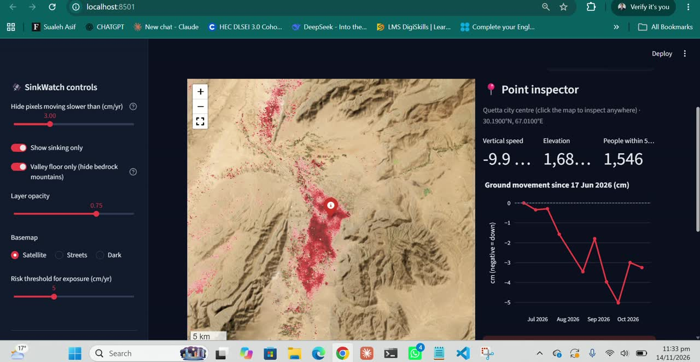
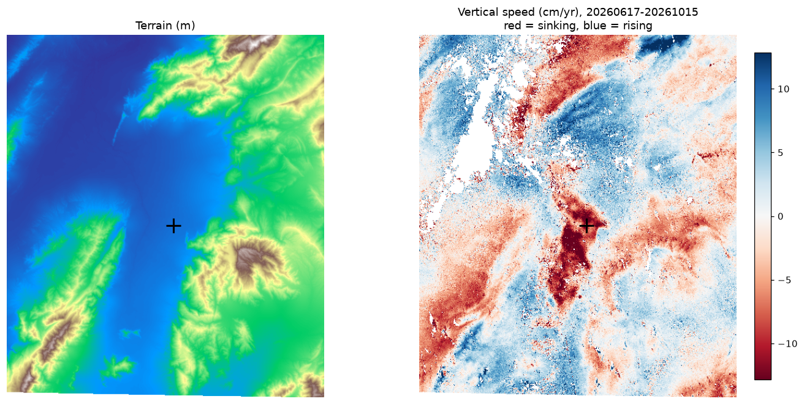

# SinkWatch: Seeing the Ground Move from Space

**NASA Space Apps Challenge 2026 · Challenge: _Dancing with the SARs_**

SinkWatch uses NASA-ISRO **NISAR** L-band radar to measure where a city is sinking, how fast it is sinking, and how many people live on that ground. The first city it covers is **Quetta, Pakistan**, one of the fastest-sinking cities in the world. Groundwater is pumped out faster than it refills, so the soft valley sediments compact and the ground drops.



## Key results (Quetta, 17 Jun to 15 Oct 2026)

| | |
|---|---|
| City-centre sinking | **≈ 9 cm per year** |
| Fastest 1% of the valley floor | **≈ 16.6 cm per year** |
| Valley floor sinking faster than 5 cm/yr | **≈ 99 km²** |
| People living on ground sinking > 5 cm/yr | **≈ 269,000** (WorldPop 2020) |
| People living on ground sinking > 10 cm/yr | **≈ 119,000** |

**Validation:** independent studies using Sentinel-1 InSAR and GPS report Quetta valley subsidence of **3.2 to 16 cm/yr**, with central Quetta at about **16 cm/yr** since 2016 (Kakar et al., 2024 and 2025). SinkWatch finds the same hotspot at the same rates using only 120 days of brand-new NISAR data.



## How it works

1. **Data:** 9 consecutive NISAR L-band Geocoded Unwrapped Interferograms (GUNW, provisional), track 041 ascending, frame 017. Each one covers a 12-day pair, and together they form an unbroken chain from 17 Jun to 15 Oct 2026.
2. **Streaming, not downloading:** each file is about 2.3 GB, 20.8 GB in total. SinkWatch streams only the Quetta window from NASA's ASF archive, using `earthaccess`, `fsspec` and `h5py`, so only a few MB come down per pair.
3. **Ionosphere:** NISAR's own split-spectrum ionosphere phase screen is subtracted from each pair.
4. **Terrain-linked troposphere and orbital tilt:** for each pair, the model `a·row + b·col + c·elevation + d` is fitted against the Copernicus GLO-30 DEM and removed. The fit only uses data **outside an 8 km circle around the city**, so the real subsidence bowl is never fitted away. This lowered the noise outside the city from 5–27 mm to 3–9 mm per pair.
5. **Stacking:** the 9 cleaned pairs are summed. Displacement is −λ/4π · phase, with λ = 24.2 cm.
6. **Vertical conversion:** line-of-sight motion is divided by cos(45.1°). Published ascending/descending comparisons for Quetta show negligible horizontal motion, which supports this step.
7. **Valley-floor mask:** statistics use only flat, low ground (elevation < 1,900 m, slope < 5°), where compressible aquifer sediments exist. Signal on the bedrock mountains is treated as residual weather.
8. **Exposure:** WorldPop 2020 (constrained, UN-adjusted) population counts are placed on the same 80 m grid.

## App features

- An interactive map of sinking speed over satellite, street or dark basemaps
- **Click anywhere** to see that spot's sinking speed, elevation, the number of people within 500 m, and a movement-over-time chart
- Exposure tables showing people and area for each risk threshold
- A validation chart comparing SinkWatch with published studies
- Method and limitations written out in plain language

## Run it

```bash
# App only (uses the prepared bundle in app_data/)
pip install -r requirements.txt
streamlit run app.py

# Full pipeline (needs a free NASA Earthdata login)
pip install -r requirements-pipeline.txt
python explore_gunw.py          # inspect a NISAR GUNW file remotely
python extract_quetta.py        # stream the Quetta window from all 9 pairs
python build_sinkwatch_map.py   # corrections, stacking, velocity
python prepare_app_data.py      # population and app bundle
streamlit run app.py
```

`urls.txt` holds the 9 NISAR GUNW download URLs exported from ASF Vertex. To run the pipeline on another city, change the bounding box and the URL list.

## Limitations

- NISAR products are **provisional**: they are calibrated, but the mission is still validating them.
- The record covers **120 days**. Quetta also has a small seasonal signal, so the annual rate is an estimate. It will sharpen as NISAR passes over every 12 days.
- Only **one viewing direction** (ascending) is used, so the motion is assumed to be vertical. Adding descending track 092 would separate vertical from east–west motion.
- Some patches away from the valley may be residual atmosphere rather than real motion.
- **Exposure is not damage:** the numbers show who lives on sinking ground, not a prediction of building damage.

## Why it matters

Groundwater-driven subsidence threatens buildings, pipelines, roads and drainage in cities from Jakarta and Mexico City to Tehran and Quetta. Most of these cities have no ground monitoring network. NISAR revisits every location every 12 days, free and open. SinkWatch shows how that data can become a map a city engineer or disaster agency can act on, and the same pipeline works for any city NISAR covers.

## Data and credits

- NASA-ISRO NISAR L-band GUNW, provisional (NASA/JPL, via ASF DAAC)
- Copernicus GLO-30 DEM (ESA)
- WorldPop 2020 Pakistan population, constrained and UN-adjusted (University of Southampton)
- Validation sources: Kakar et al. (2025) *Natural Hazards*, doi:10.1007/s11069-025-07226-y; Kakar et al. (2024) *Remote Sensing* 16(9):1521

Built solo by **Muhammad Asif** for the NASA Space Apps Challenge 2026. MIT License.
